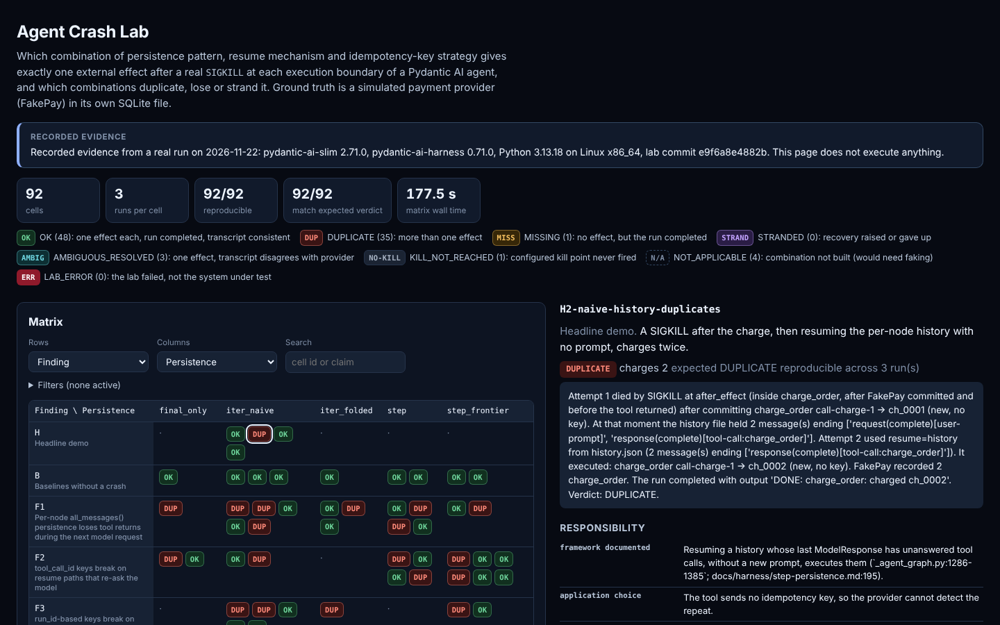
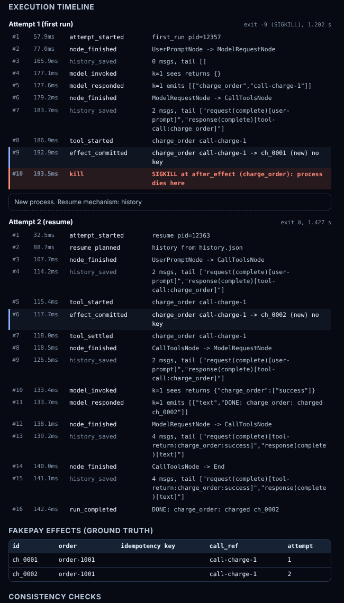
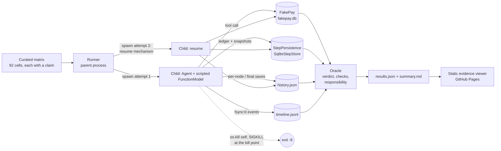

# 💥 Agent Crash Lab

### Kill a Pydantic AI agent right after it charges a card. Resume it. Count the charges.

A reproducible **`SIGKILL` crash matrix** for side-effecting tools in
[Pydantic AI](https://github.com/pydantic/pydantic-ai) agents. It measures which combinations of
**persistence pattern × resume mechanism × effect-key strategy** leave exactly one external effect
after a real process death at each execution boundary. It also shows which combinations silently
duplicate, lose or strand that effect.

[](https://github.com/MoallaMelek/agent-crash-lab/actions/workflows/ci.yml)
[](https://moallamelek.github.io/agent-crash-lab/)


**[→ Explore the recorded evidence](https://moallamelek.github.io/agent-crash-lab/)** (static page: recorded results only, nothing is executed in your browser)



> **Status.** A working research tool, pinned to `pydantic-ai-slim 2.71.0` and `pydantic-ai-harness 0.71.0`
> (latest on PyPI on 2026-11-22). 92 curated cells, each run three times, give the same result
> every time. The model is scripted (`FunctionModel`, no LLM, no network). The external system is
> simulated (`FakePay`, its own SQLite file). This is an independent project with **no
> affiliation with or endorsement by Pydantic**. It did **not** find a bug in Pydantic AI: every
> duplicate it measures is consistent with the documented behaviour. What it adds is *which*
> application choices land you in each documented failure window.

---

## 🧭 The engineering question

An agent calls a tool that has an external side effect. The process dies before the agent's state
is durably recorded. Later it resumes. **Does the effect happen zero, one or two times?**

Pydantic AI is explicit about this. Every durable-execution backend documents at-least-once
delivery for the tool in flight. The harness
[`StepPersistence`](https://pydantic.dev/docs/ai/harness/step-persistence/) capability keeps a
tool-effect ledger, but says plainly that *"side-effect deduplication is the orchestrator's
responsibility"*. So "make your tools idempotent" is not news. The lab measures the part the docs
leave to you: **which resume path, which persistence pattern and which idempotency key actually
hold up**, using real `SIGKILL`s rather than raised exceptions.

The research behind the design is in [`docs/PYDANTIC_RESEARCH.md`](docs/PYDANTIC_RESEARCH.md).
It covers source paths at commit `463a6d5`, an issue survey including
[#10926](https://github.com/pydantic/pydantic-ai/issues/10926) and
[#11951](https://github.com/pydantic/pydantic-ai/issues/11951), and experiments. The scope
decisions are in [`docs/ENGINEERING_DECISIONS.md`](docs/ENGINEERING_DECISIONS.md), including why
a plain "naive retry vs idempotency" demo was **rejected as redundant**.

## 🔬 What the matrix shows

Recorded on 2026-11-22, lab commit `e9f6a8e`. Counts are FakePay rows for one order; the expected
value is one charge.

| # | Finding | Cell (evidence) | Charges |
|---|---|---|---|
| H | Kill after the charge, then resume the saved history with no prompt: the dangling call runs again. This is documented behaviour. | `H2-naive-history-duplicates` | **2** |
|   | The same crash with a business key (`order:{id}:charge`) or with provider reconciliation | `H3-business-key-dedupes`, `H4-reconcile-dedupes` | 1 |
| F1 | Saving `run.all_messages()` at every `agent.iter` node loses the tool return for the whole next model request. The return lives in `node.request` until then. | `F1-iter-naive-next-request` | **2** |
|   | Folding `node.request` into the saved history closes that window | `F1-iter-folded-next-request` | 1 |
| F2 | A `tool_call_id` key fails on resume paths that **re-ask the model**: StepPersistence's default `continue_run`, a restart after `LookupError`, or a plain restart. A real provider mints a new id. | `F2-step-default-tcid-fresh`, `F2-restart-tcid-fresh` | **2** |
|   | The same with `include_interrupted=True` (keeps the dangling response), or with a business key | `F2-step-frontier-interrupted-tcid-fresh`, `F2-step-default-business-fresh` | 1 |
| F3 | A `run_id:tool_call_id` key fails on every resume that re-executes the call, because `ctx.run_id` is new per run (the same class of bug as #11951) | `F3-iter-naive-history-runid` | **2** |
| F4 | After a synthesized `interrupted` return, a model that re-issues the call gets a *new* id. Only a business key stops it. | `F4-repair-reissue`, `F4-repair-reissue-tcid`, `F4-repair-reissue-business` | **2**, **2**, 1 |
| F5 | `DeferredToolResults(calls={id: value})` resolves a dangling call that was *never deferred*. It works as a reconciliation hook, but this is not documented. | `F5-step-frontier-reconcile-fresh`, `F5-parallel-iter-naive-reconcile` | 1 |
|   | Reconciliation degrades honestly when no snapshot holds the dangling call | `F5-step-default-reconcile-degraded` | **2** |

Totals over 92 cells: **48 OK · 35 DUPLICATE · 3 AMBIGUOUS_RESOLVED · 1 MISSING · 4 NOT_APPLICABLE ·
1 KILL_NOT_REACHED** (a lab self-check) · 0 LAB_ERROR. The full table is in
[`docs/evidence/latest/summary.md`](docs/evidence/latest/summary.md), and every raw record is in
[`results.json`](docs/evidence/latest/results.json).

### Three things worth knowing if you run agents in production

1. **The default `continue_run` read path is not neutral.** It returns the last `complete` snapshot,
   which after a kill mid-first-cycle is just the prompt. The model is asked again. Any key derived
   from the call id is lost, even though the ledger already says `started`, or even `completed`
   (`F1-step-during-snapshot-write`).
2. **Key on what the effect *is*, not on how the agent got there.** `run_id` changes on every run.
   `tool_call_id` and the response-origin key from #11960 change whenever the model is re-asked. A
   business key survives every path in this matrix, including a model that re-issues the call.
   The trade-off: it also suppresses a legitimate second identical order.
3. **Reconcile before you resume.** Read the ledger or the dangling calls, look the effect up at the
   provider, and inject the result with `DeferredToolResults`. This needs a history that still
   holds the dangling call (`step_frontier` + `include_interrupted`, or folded `iter` saves).

## 🔍 One cell, end to end

This is real output of `uv run crashlab run H2-naive-history-duplicates`, abridged:

```text
cell    H2-naive-history-duplicates
claim   A SIGKILL after the charge, then resuming the per-node history with no prompt, charges twice.
config  single_charge iter_naive resume=history key=none ids=stable model=trust kill=after_effect

  a1 #08    69.9ms  tool_started           charge_order call-charge-1
  a1 #09    71.8ms  effect_committed       charge_order call-charge-1 -> ch_0001 (new)
  a1 #10    72.1ms  KILL (SIGKILL) at after_effect  charge_order
  a2 #01    19.0ms  attempt_started        resume pid=13535
  a2 #02    47.1ms  resume_planned         history from history.json calls=[] approvals=[]
  a2 #05    62.0ms  tool_started           charge_order call-charge-1
  a2 #06    63.7ms  effect_committed       charge_order call-charge-1 -> ch_0002 (new)
  a2 #16    73.7ms  run_completed          DONE: charge_order: charged ch_0002

  FakePay charge ch_0001 order=order-1001 key=None call_ref=call-charge-1 attempt=1
  FakePay charge ch_0002 order=order-1001 key=None call_ref=call-charge-1 attempt=2

verdict DUPLICATE  effects={'charge_order': 2}  expected=DUPLICATE
  - [framework_documented] Resuming a history whose last ModelResponse has unanswered tool
    calls, without a new prompt, executes them (`_agent_graph.py:1286-1385`; docs/harness/step-persistence.md:195).
  - [application_choice] The tool sends no idempotency key, so the provider cannot detect the repeat.
```

The viewer shows the same cell as a two-attempt timeline, with the kill marker, the FakePay rows
and the consistency checks:

<p align="center"></p>

## 🏗️ Architecture



- **A real crash, not an exception.** The child appends a `kill` event, `fsync`s it, and calls
  `os.kill(os.getpid(), SIGKILL)`. No `finally`, `atexit` or flush runs. The runner refuses to
  classify a cell unless attempt 1 exited with `-9` and the kill was its last event. A kill point
  that never fires is reported as `KILL_NOT_REACHED`, not silently passed. In-process exceptions are
  a separate, labelled axis (`crash=exception`), because Pydantic AI handles them differently.
- **Ground truth outside the agent.** FakePay is a separate SQLite file (WAL,
  `synchronous=FULL`) with Stripe-like idempotency keys: the same key returns the original charge.
  It is the only thing the oracle counts.
- **Every axis value is a real API path.** `continue_run(include_interrupted=)`, `repair_messages`,
  `DeferredToolResults(calls=, approvals=)`, `capture_frontier=True`, `ModelMessagesTypeAdapter`.
  Combinations that would need a faked mechanism are `NOT_APPLICABLE`.
- **Responsibility is labelled on every verdict.** Each factor is tagged
  `framework_documented`, `framework_observed`, `application_choice`,
  `provider_assumption` or `scripted_model_behaviour`.

Exact kill-point definitions, with line references into Pydantic AI at `463a6d5`, are in
[`docs/ARCHITECTURE.md`](docs/ARCHITECTURE.md).

### The axes

| Axis | Values |
|---|---|
| Kill point | `none` · `before_effect` · `after_effect` · `after_tool_node` · `during_next_model_request` · `mid_parallel_batch` · `during_snapshot_write` · `after_snapshot_write` |
| Persistence | `final_only` · `iter_naive` (`all_messages()` per node) · `iter_folded` (+ `node.request`) · `step` (StepPersistence defaults) · `step_frontier` (`capture_frontier=True`) |
| Resume | `restart` · `history` (no prompt) · `continue_default` · `continue_interrupted` · `repair` (`repair_messages` + prompt) · `reconcile` (provider lookup → `DeferredToolResults`) |
| Effect key | `none` · `run_id+tool_call_id` · `tool_call_id` · `response_origin` (#11960 style) · `business` (`order:{id}:charge`) |
| Model | `ids=stable\|fresh` · after an `interrupted` return: `trust\|reissue` |
| Scenario | `single_charge` · `charge_then_notify` · `parallel_batch` |

## 🚀 Quick start

POSIX only (Linux or macOS), Python 3.11 or newer, [uv](https://docs.astral.sh/uv/). No API keys, no GPU, no network after install.

```bash
git clone https://github.com/MoallaMelek/agent-crash-lab.git
cd agent-crash-lab
uv sync
uv run crashlab doctor                          # versions + one real SIGKILL smoke cell
uv run crashlab run H2-naive-history-duplicates # watch a duplicate charge happen
uv run crashlab run H2-naive-history-duplicates --set key=business   # change one axis
```

```bash
uv run crashlab list                            # every cell and the claim it tests
uv run crashlab matrix -j 4                     # 92 cells, about a minute on 2 cores
uv run crashlab matrix -j 4 --repeat 3 --check --out evidence/$(date +%F)
uv run crashlab report evidence/$(date +%F)/results.json --out site/   # build the viewer locally
uv run crashlab run custom --set persistence=step_frontier --set kill=after_effect \
    --set resume=reconcile --set ids=fresh      # any combination of axes
```

`--check` exits non-zero if any verdict differs from its curated expectation, or if a cell is not
reproducible. When pinned versions are bumped, it tells you which documented behaviour changed.
See [`docs/USAGE.md`](docs/USAGE.md) for every command, axis and exit code.

## 🧪 Testing

```bash
uv run pytest                     # 107 tests, ~40 s (33 spawn real subprocesses)
uv run ruff check src tests && uv run ruff format --check src tests
uv run mypy                       # strict, on src/
```

Branch coverage is 92%, including the child processes. CI runs lint, types and tests on Ubuntu
and macOS with Python 3.11 and 3.13, then runs `crashlab matrix --check`.

**Independent verification.** A separate review re-checked every Pydantic API the lab uses
against the installed packages. It traced verdicts by hand to the raw SQLite and JSONL records,
and re-ran the matrix twice with identical results. It found and fixed two labelling bugs in the
oracle; no verdict changed. See [`docs/VERIFICATION.md`](docs/VERIFICATION.md).

**Measured runtime** (2-core Linux container, `-j 4`): one matrix pass takes about 60 s;
`--repeat 3` takes 177.5 s. These are not benchmarks of Pydantic AI.

## ⚖️ Guarantees and honest limitations

- **No exactly-once claim.** An `OK` cell means one effect *in this scenario*, with a provider
  that honours idempotency keys or supports lookup. It is not a framework guarantee.
- **Some `OK`s depend on stable ids.** With `ids=stable` (the default), a re-asked model reuses
  the same call id, so `tool_call_id` keys look fine. Real providers mint new ids. Those cells say
  *"only because ids=stable"* in their responsibility labels; compare them with their `ids=fresh`
  twins.
- **Scripted model behaviour.** "Fresh ids" and "re-issues after `interrupted`" are scripted
  `FunctionModel` behaviours. They are not measured from a real provider or LLM, and they are not
  rates.
- **SIGKILL is not power loss.** The OS page cache survives a `SIGKILL`, so nothing here tests
  `fsync` ordering or torn writes after a power failure.
- **`during_snapshot_write`** kills *before* the store write starts, not inside the SQLite
  transaction. Treating that as equivalent is an inference (see `ARCHITECTURE.md`).
- **Not covered:** Temporal, DBOS, Prefect and Restate (each needs its own server; their docs
  already state at-least-once delivery). Also not covered: MongoDB and Postgres step stores,
  streaming runs, and Windows.
- **What a Pydantic maintainer could fairly push back on.** F3 is expected from documented
  `run_id` semantics. F1 is about how an application saves history, not a framework defect.
  F5 relies on undocumented behaviour that may change. `MISSING` and `AMBIGUOUS_RESOLVED` are this
  lab's categories; in those cells the agent honestly reports `STATUS UNKNOWN`.

## 🧰 Tech stack

| Area | Choice |
|---|---|
| System under test | `pydantic-ai-slim==2.71.0`, `pydantic-ai-harness==0.71.0` (`StepPersistence`, `SqliteStepStore`) |
| Model | `FunctionModel` scripts, `ALLOW_MODEL_REQUESTS = False` |
| Ground truth | SQLite (`FakePay`), append-only fsync'd JSONL timeline |
| Process control | `subprocess` + `os.kill(getpid(), SIGKILL)`, per-attempt timeouts |
| CLI | `argparse`, stdlib only |
| Viewer | Single self-contained HTML file: no CDN, no network, light and dark themes |
| Quality | pytest, coverage, ruff, mypy `--strict`, GitHub Actions, uv lockfile |

## 📁 Repository structure

```text
src/crashlab/
  provider.py      FakePay: SQLite charges/notifications, idempotency keys, lookup
  scenarios.py     Deterministic FunctionModel agents (single, sequential, parallel)
  keys.py          Effect-key strategies and their documented failure modes
  persistence.py   final_only / iter_naive / iter_folded / step / step_frontier
  resume.py        restart / history / continue_* / repair / reconcile
  faults.py        Kill points: real SIGKILL or labelled in-process exception
  child.py         One attempt in its own process
  runner.py        Spawns attempts, verifies -9, collects every record
  oracle.py        Verdicts, consistency checks, explanations, responsibility
  matrix.py        92 curated cells (each with a claim and expected verdict), --full product
  evidence.py      results.json (schema-versioned) + summary.md
  cli.py           crashlab list | run | matrix | report | doctor
  viewer/          Static evidence viewer template
tests/             Unit, subprocess, determinism and viewer tests
docs/
  PYDANTIC_RESEARCH.md      What Pydantic AI guarantees, with sources and experiments
  ENGINEERING_DECISIONS.md  Scope, oracle, rejected alternatives
  ARCHITECTURE.md           Module map, kill-point definitions with source references
  VERIFICATION.md           Independent review: method, findings, fixes
  UPSTREAM_NOTES.md         Unposted draft notes for issue #10926
  evidence/latest/          The recorded run the viewer is built from
  research-experiments/     The original experiment scripts and their outputs
evidence/2026-11-22/        Dated copy of the recorded run
```

## 🤝 Contributing

Issues and pull requests are welcome. Especially useful:

- cells for durable-execution backends;
- a real-provider id-behaviour study;
- MongoDB and Postgres step stores.

Please keep each new cell tied to one claim with an expected verdict, and run
`uv run crashlab matrix --check` and the test suite before opening a PR. Never edit evidence by
hand; regenerate it.

This project does not propose changes to Pydantic AI on its own. Pydantic's
[contribution policy](https://github.com/pydantic/pydantic-ai/blob/main/CONTRIBUTING.md) asks for
an agreed issue first. [`docs/UPSTREAM_NOTES.md`](docs/UPSTREAM_NOTES.md) is an unposted draft.

## 📄 License and ownership

[MIT](LICENSE) © 2026 **Melek Moalla**, AI Engineering student at ESPRIT, Tunisia
([@MoallaMelek](https://github.com/MoallaMelek)).

Pydantic and Pydantic AI are trademarks of their respective owners. This repository is not
affiliated with or endorsed by them.
