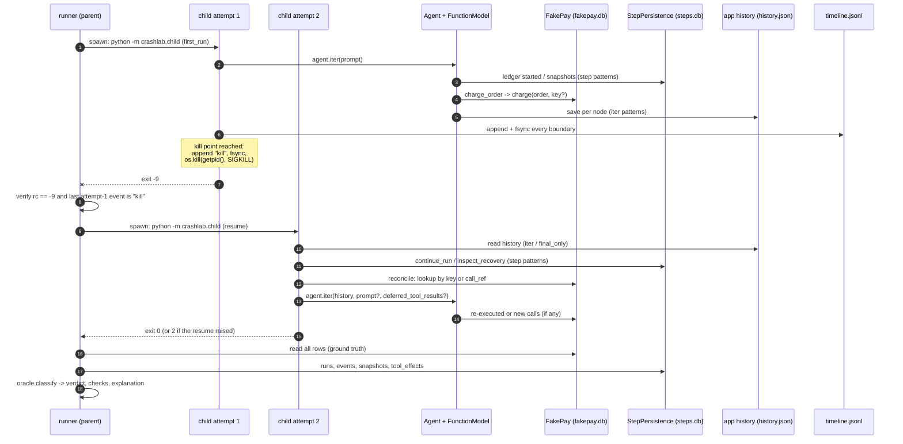

# Architecture

This page describes how a cell runs, what each kill point means relative to Pydantic AI's
lifecycle, and how a verdict is reached. Source references are to pydantic-ai commit
[`463a6d5`](https://github.com/pydantic/pydantic-ai/tree/463a6d519b7e4c8e038d5a2559b0d26281df6937).
The installed `pydantic-ai-slim 2.71.0` and `pydantic-ai-harness 0.71.0` are line-for-line identical
for every file cited here: only two `# noqa` comments differ.

Abbreviations:

- `core/` is `pydantic_ai_slim/pydantic_ai/`.
- `sp/` is `src/pydantic_ai_harness/pydantic_ai_harness/step_persistence/`.

## Module map

| Module | Role |
|---|---|
| `crashlab/config.py` | The axes (`CellConfig`), constants (order, prompt), and the **N/A rules** (`not_applicable_reason`). |
| `crashlab/provider.py` | FakePay: SQLite ground truth for charges and notifications, with Stripe-like idempotency keys. |
| `crashlab/keys.py` | Effect-key strategies, and `reconstruct_key` for reconciliation. Each strategy's failure mode is in the module docstring. |
| `crashlab/scenarios.py` | The scripted `FunctionModel` (stable or fresh ids; trusts or re-issues after `interrupted`), the two tools, and agent assembly. |
| `crashlab/faults.py` | The fsync'd `Timeline`, `FaultPlan` (one kill, attempt 1 only), the two probe capabilities, and `InstrumentedSqliteStepStore`. |
| `crashlab/persistence.py` | Persistence patterns: `drive()` runs `agent.iter` and saves per pattern. Also the atomic `HistoryFile`. |
| `crashlab/resume.py` | Resume mechanisms: `plan_resume()` and the `reconcile` helper (`dangling_calls`, provider lookup, `DeferredToolResults`). |
| `crashlab/child.py` | One attempt in one process: `python -m crashlab.child <config.json>`. |
| `crashlab/runner.py` | Parent side. Spawns the attempts, verifies the kill, collects evidence, classifies. |
| `crashlab/oracle.py` | Verdict, consistency checks, generated explanation, responsibility factors, and the reproducibility fingerprint. |
| `crashlab/matrix.py` | The curated cells (id, claim, expected verdict), the full product, and the parallel/repeat driver. |
| `crashlab/evidence.py` | `results.json` (schema `crashlab.results/v1`) and `summary.md`. |
| `crashlab/viewer/` | The self-contained static viewer (`template.html`, plus the embedding code). |
| `crashlab/cli.py` | The `crashlab` command. |

## Flow of one cell



The workdir is a fresh temporary directory per cell, so nothing leaks between cells or repeats.
Every subprocess has a timeout. A timeout in attempt 1 is a `LAB_ERROR`; a timeout in attempt 2 is
`STRANDED`.

## Kill points

Each kill fires at most once, in attempt 1 only. Before it kills the process, the child appends a
`kill` line to `timeline.jsonl` and fsyncs it. The runner checks two things:

- `returncode == -SIGKILL`;
- the `kill` line is the *last* attempt-1 event, so nothing ran after it.

If a configured point never fires, the verdict is `KILL_NOT_REACHED`. Any other mismatch is a `LAB_ERROR`.

| Kill point | Exactly where | Relative to Pydantic AI |
|---|---|---|
| `before_effect` | In the target tool's body, before the FakePay call. | Inside `toolset.call_tool`. StepPersistence has already written `started` in `before_tool_execute` (`sp/_capability.py:615`). |
| `after_effect` | In the target tool's body, after `FakePay.charge()` committed, before `return`. | Same frame. `after_tool_execute` (`sp/_capability.py:634`) has not run, so the ledger still says `started`. |
| `after_tool_node` | `NodeBoundaryProbe.after_node_run`, for the `CallToolsNode` whose response called the target tool. | `after_node_run` dispatches in **reverse** capability order (`core/capabilities/combined.py:664`). The probe is last in the list, so it runs *before* StepPersistence's `after_node_run` (`sp/_capability.py:712`) saves the settled snapshot, and before `AgentRun.next` (`core/run.py:631`) returns the next node to the application's iter loop. No snapshot and no application history save covers this tool cycle yet; only the StepPersistence ledger (step patterns) has recorded it, as `completed`. |
| `during_next_model_request` | Inside the scripted model function, on the first invocation whose messages contain a return for the target tool. | That is `ModelRequestNode.run` (`core/_agent_graph.py:2634`) for the request that carries the tool returns. A sync `FunctionModel` function runs in a worker thread (`core/models/function.py:178-181`), and SIGKILL from any thread kills the process. Here the iter patterns' `run.all_messages()` does not contain the returns yet: they live in the yielded node's `node.request` (exp3). |
| `mid_parallel_batch` | In `notify_customer`, once `charge_order` (same `ModelResponse`) has settled, before the notification's effect. | Default `'parallel'` mode runs both calls as tasks (`core/_tool_execution.py:1036`). `ToolSettledSignal` is first in the capability list, and `after_tool_execute` dispatches in reverse (`core/capabilities/combined.py:910`), so its signal fires after StepPersistence has written `completed` for the charge. The batch has not settled, so no snapshot carries the charge result (`docs/harness/step-persistence.md:724-729`). |
| `during_snapshot_write` | `InstrumentedSqliteStepStore.save_snapshot`, on the first snapshot that contains a return for the target tool, before delegating to `SqliteStepStore.save_snapshot` (`sp/_store.py:1374`). | No row is written. SQLite commits that snapshot in one `BEGIN IMMEDIATE` transaction, so a kill anywhere before COMMIT is assumed to be equivalent. That assumption is INFERRED from SQLite semantics; the lab does not kill inside the transaction. |
| `after_snapshot_write` | The same wrapper, right after the delegate returned (committed). | The settled snapshot is durable. StepPersistence has not yet emitted `SnapshotSavedEvent`. |

**Crash mode `exception`.** This is defined for `before_effect` and `after_effect` only. The child
raises `InjectedCrash` instead of SIGKILL, and the effect is labelled as an in-process failure.
`CallToolsNode` catches `BaseException` and appends `ModelRequest(state='interrupted')`
(`core/_agent_graph.py:4624-4645`). Application-history patterns then save the
`capture_run_messages()` list (`core/_agent_graph.py:5313`), which is the pattern `docs/agent.md`
recommends. StepPersistence saves its own at-failure snapshot in `on_run_error`
(`sp/_capability.py:541`). The child exits 3.

## Persistence patterns

The application patterns run `agent.iter`, and the loop in `crashlab/persistence.py:drive` saves
after each `run.next()`:

- `iter_naive` saves `run.all_messages()`.
- `iter_folded` also saves `node.request` when the yielded node is a `ModelRequestNode`.
- `final_only` saves once, after `End`.

Every save goes through `HistoryFile`: temp file, fsync, `os.replace`, then a directory fsync.

The step patterns add `StepPersistence(store=InstrumentedSqliteStepStore(...), run_id='crashlab-run-a<attempt>')`.
`capture_frontier=True` turns `step` into `step_frontier`. The `run_id` is explicit, so attempt 2
can address attempt 1's records. A fresh process cannot reuse the id: StepPersistence rejects that
in `_register_run`.

Capability order is part of the kill-point definitions:

```python
[ToolSettledSignal, StepPersistence (step patterns only), NodeBoundaryProbe]
```

## Resume mechanisms

These are implemented in `crashlab/resume.py:plan_resume`. That function only reads state; tools
execute later, in `drive()`.

| Mechanism | History source | Passed to `agent.iter` |
|---|---|---|
| `restart` | none | the original prompt |
| `history` | `history.json` | `message_history`, no prompt (dangling calls execute: `core/_agent_graph.py:1286-1385`) |
| `continue_default` | `continue_run(store, run_id=a1)` (`sp/_helpers.py:84`), `complete` snapshots only | `message_history`, no prompt |
| `continue_interrupted` | `continue_run(..., include_interrupted=True)` | `message_history`, no prompt |
| `repair` | file, or the newest snapshot including `interrupted` | `repair_messages(history)` and a new "continue" prompt |
| `reconcile` | file, or `inspect_recovery(...).latest` | `message_history`, plus `DeferredToolResults(calls={found: result}, approvals={not_found: True})` |

**Fallback.** When the needed history does not exist (no file, or `LookupError` from
`continue_run`), the mechanism falls back to `restart`. The resume plan records this, and the
evidence shows it. `reconcile` is marked `degraded` in this case. It still lists what the ledger
and the provider know about the unresolved calls, but it cannot inject a result for a call that no
persisted `ModelResponse` carries.

**Why approvals.** Once any deferred result is supplied, core requires a result for *every*
dangling call in the response (`core/_tool_execution.py:548-560`). For calls the provider does not
have, `reconcile` therefore passes `approvals={id: True}`, which makes them execute. The lab
observed that this works on 2.71.0 for calls that were never deferred. It is not documented for
this use.

**N/A.** These rules live in `config.not_applicable_reason`:

- `continue_*` needs StepPersistence.
- `history` with StepPersistence is spelled `continue_*`.
- The snapshot kill points need a store.
- `mid_parallel_batch` needs `parallel_batch`.
- Crash mode `exception` is defined only for the tool-body points.

## Oracle

The order of checks is in `crashlab/oracle.py`. Ground truth is the FakePay rows for `order-1001`.
The expected count is one charge, plus one notification for the two-tool scenarios.

| Verdict | Condition |
|---|---|
| `NOT_APPLICABLE` | The N/A rule matched. Nothing was spawned. |
| `LAB_ERROR` | Unexpected exit code, a timeout in attempt 1, or a runner exception. |
| `KILL_NOT_REACHED` | A kill was configured and attempt 1 has no `kill` event. |
| `DUPLICATE` | Any expected tool has more than 1 effect. This is checked before `STRANDED`, because a second charge is an external fact. |
| `STRANDED` | The final attempt did not complete. |
| `MISSING` | Any expected tool has 0 effects, and the run completed. |
| `AMBIGUOUS_RESOLVED` | Exactly one of each effect, but the final transcript disagrees with FakePay: the last return for the tool is not `success` (for example a synthesized `interrupted`), or a provider effect is never mentioned. |
| `OK` | None of the above. |

**Consistency checks.** These are reported per cell:

- `timeline_vs_provider`: lab instrumentation against the provider rows.
- `transcript_vs_provider`: orphan effects, and mentioned ids that do not exist.
- `interrupted_but_effect_exists`.
- For the step patterns, attempt 1's ledger against attempt 1's effects and snapshots:
  - `started` with or without an effect;
  - `failed` but with an effect;
  - `completed` but carried by no snapshot.

**Explanation and responsibility.** Both are generated from the timeline, the resume plan and the
provider rows. Each responsibility factor carries one of these categories:

- `framework_documented`
- `framework_observed` (verified behaviour, not documented)
- `application_choice`
- `provider_assumption`
- `scripted_model_behaviour`
- `lab`

**Reproducibility.** A fingerprint hashes the verdict, the effect counts, and the multiset of
timeline events with volatile fields removed: run ids, timestamps, pids and key values. The
multiset ignores order, because the StepPersistence store writes run on worker threads.
`matrix --repeat N` requires identical fingerprints.

## What is not measured

- **Power loss, fsync semantics, torn writes.** SIGKILL leaves the OS page cache intact.
- **Durable engines** (Temporal, DBOS, Prefect, ...). Their docs already state at-least-once delivery for the unit in flight.
- **Real LLMs and real providers.**
  - "Fresh ids" model provider behaviour; they are not observed from a provider.
  - `reissue` models a plausible LLM reaction; it is not a measured rate.
- **Many orders, concurrent runs, or key collisions across runs.** For example, stable `tool_call_id`s reused by a provider for a different order would make the `tool_call_id` key merge distinct charges.
